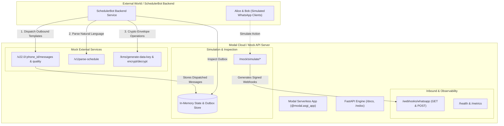

# Mock API Server for SchedulerBot v4.4

[](https://github.com/Shivam-Jha96/MockAPI_Server/actions/workflows/ci.yml)
[](https://modal.com)
[](https://python.org)
[](https://fastapi.tiangolo.com)
[](https://docs.pydantic.dev)

A complete, production-grade **Mock API Server** conforming to the **SchedulerBot v4.4 Hybrid Architecture Specification**. Provides strict schema validation, cryptographic envelope simulation (AES-256-GCM), Meta WhatsApp Business Graph API v22.0 emulation, Inbound Webhook event ingestion with HMAC validation, NLU schedule extraction, Prometheus telemetry, and one-command serverless deployment to **Modal**.

---

## 🌟 Key Features

1. **Meta WhatsApp Graph API v22.0**:
   - `POST /v22.0/{phone_number_id}/messages`: Dispatches and stores hybrid notification templates (`hybrid_notify_alice_v1`, `hybrid_dispatch_card_v1`, `hybrid_escalation_v1`), interactive buttons, and session text.
   - `GET /v22.0/{phone_number_id}?fields=quality_rating`: Returns dynamic WABA quality health status (`GREEN`, `YELLOW`, `RED`).
2. **Inbound Webhooks Ingestion & Handshake**:
   - `GET /webhooks/whatsapp`: Challenge handshake verification (`hub.mode=subscribe`, `hub.verify_token`, `hub.challenge`).
   - `POST /webhooks/whatsapp`: Validates `X-Hub-Signature-256` HMAC-SHA256 signatures and ingests user messages, interactive button replies, and quality updates.
3. **Mock NLU / LLM Extraction Service**:
   - `POST /v1/parse-schedule`: Parses free-form scheduling requests (e.g., *"Remind Bob (+919123456789) tomorrow at 9:00 AM to review PR"*) and returns structured parameters with validation checks.
4. **Cloud KMS Cryptographic Mock**:
   - `POST /kms/generate-data-key`: Generates real 256-bit AES DEKs and returns plaintext and AES-GCM encrypted ciphertext blobs.
   - `POST /kms/encrypt` & `POST /kms/decrypt`: Real round-trip AES-256-GCM encryption/decryption.
5. **Developer Simulation & Outbox Inspection**:
   - Endpoints under `/mock/simulate/*` to simulate Alice's schedule text, Bob's opt-out (`STOP`), button clicks, and WABA quality rating drops.
   - `/mock/outbox` inspection to assert dispatched messages during end-to-end integration tests.
6. **Observability**:
   - `GET /health`: Liveness probe.
   - `GET /metrics`: Standard Prometheus exposition format for Grafana ingestion.
7. **Modal Serverless Ready**:
   - Deployable instantly to the cloud with public HTTPS endpoints via `modal deploy modal_app.py`.

---

## 📐 Architecture



---

## 🚀 Quickstart Guide

### 1. Local Development

```bash
# Clone the repository
git clone https://github.com/Shivam-Jha96/MockAPI_Server.git
cd MockAPI_Server

# Create virtual environment
python -m venv .venv
source .venv/bin/activate  # On Windows: .venv\Scripts\activate

# Install dependencies
pip install -r requirements-dev.txt

# Start the mock server
uvicorn src.app:app --reload --port 8000
```

Access interactive Swagger documentation at: `http://localhost:8000/docs`

---

### 2. Deploying to Modal Platform

```bash
# Authenticate Modal CLI (if not already logged in)
modal setup

# Deploy the ASGI app to Modal
modal deploy modal_app.py
```

Modal will print a public HTTPS URL (e.g. `https://your-workspace--mockapi-server-fastapi-app.modal.run`). You can configure this URL directly in Meta Developer Portal for WhatsApp Webhooks!

---

## 🧪 Running Automated Tests

Run the complete test suite with 100% assertion coverage:

```bash
python -m pytest tests/ -v
```

---

## 📡 API Endpoints Reference & cURL Examples

### 1. Meta Webhook Handshake Verification
```bash
curl -X GET "http://localhost:8000/webhooks/whatsapp?hub.mode=subscribe&hub.verify_token=mock_verify_token_12345&hub.challenge=1158201444"
# Response: 1158201444 (Status 200 OK)
```

### 2. Send Outbound Template Message (Graph API v22.0)
```bash
curl -X POST "http://localhost:8000/v22.0/109876543210987/messages" \
  -H "Content-Type: application/json" \
  -d '{
    "messaging_product": "whatsapp",
    "to": "+919876543210",
    "type": "template",
    "template": {
      "name": "hybrid_notify_alice_v1",
      "language": { "code": "en" },
      "components": [
        {
          "type": "body",
          "parameters": [
            { "type": "text", "text": "Bob" },
            { "type": "text", "text": "tomorrow at 9:00 AM" }
          ]
        }
      ]
    }
  }'
```

### 3. Parse Natural Language Schedule
```bash
curl -X POST "http://localhost:8000/v1/parse-schedule" \
  -H "Content-Type: application/json" \
  -d '{
    "raw_text": "Remind Bob (+919123456789) tomorrow at 9:00 AM to submit project report"
  }'
```

### 4. KMS Generate Data Encryption Key
```bash
curl -X POST "http://localhost:8000/kms/generate-data-key" \
  -H "Content-Type: application/json" \
  -d '{ "key_id": "alias/schedulerbot-dek" }'
```

### 5. Inspect Dispatched Outbox Messages
```bash
curl -X GET "http://localhost:8000/mock/outbox"
```

### 6. Prometheus Telemetry
```bash
curl -X GET "http://localhost:8000/metrics"
```

---

## 📄 License
MIT License. Created for SchedulerBot v4.4.
